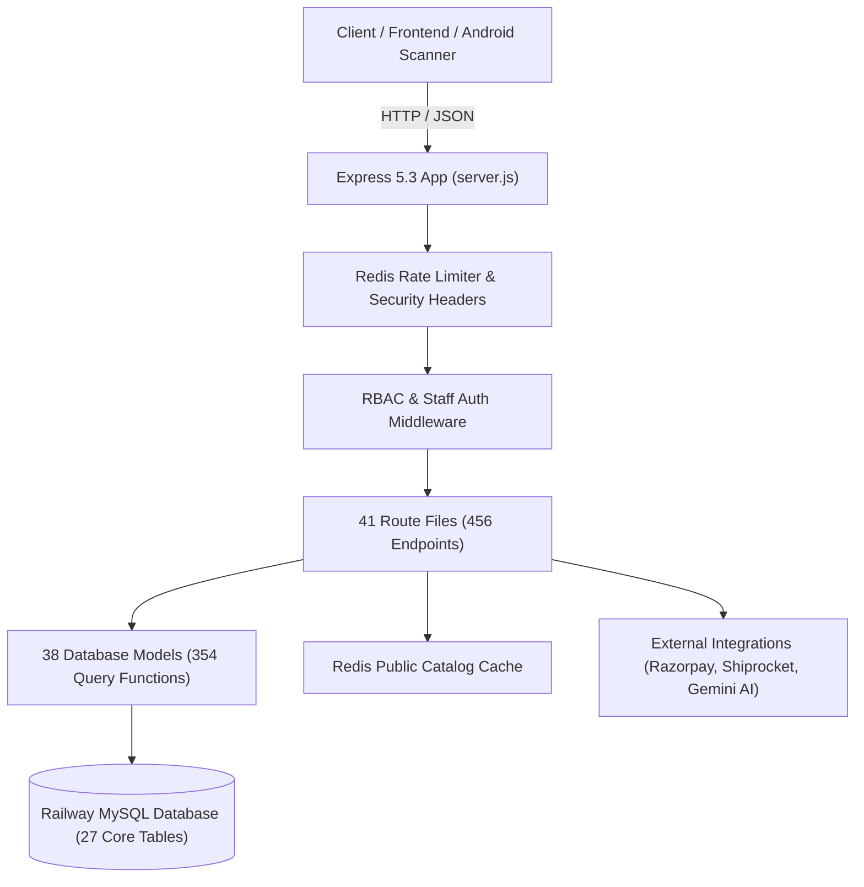

# 🗺️ Bhumivera Backend — Architectural Blueprint & Systems Specification

> **Repository**: `Bhumivera_Backend`  
> **Runtime**: Node.js 22.x + Express 5.3 (`server.js`, `index.js`)  
> **Database**: MySQL 8.0 (`mysql2/promise` pool in `config/db.js`)  
> **Cache**: Redis 7.x (`middleware/redisResponseCache.js`, `middleware/rateLimiter.js`)  
> **Deployment Target**: Railway (`https://service.bhumivera.com`) + Vercel serverless fallback  
> **Last Verified Audit**: 2026-11-03 (Migration v79 Baseline)

---

## 1. System Topology & Request Lifecycle

---

## 2. Core Operational Modules

1. **Order Lifecycle & Delivery Engine (`routes/orderRoutes.js`, `models/orderModel.js`)**:
   - `calculateEstimatedDeliveryDate(address, deliveryType)`: Computes delivery checkpoints (+2 days East India, +4 days Metros, +5 days Rest of India).
   - Atomic inventory deduction during checkout for products and component SKUs in Regimen Bundles.
   - Razorpay webhook verification and wallet refund processing.
2. **Omnichannel Inventory Software Engine (`routes/inventorySoftwareRoutes.js`, `models/inventorySoftwareModel.js`)**:
   - **57 Dedicated Endpoints**: Online order dispatch lifecycle, 4x6 courier shipping labels, undelivered RTO return/restock, master stock lock, offline POS billing, mobile QR scanner bridge (`POST /scanner/scan`), storage bin keeper (`/storage-bins`), GRN inwarding, and physical stock audit.
3. **Daily SQL Disaster Recovery & Backup Engine**:
   - Table `system_daily_backups`: Stores full daily SQL dump with `CREATE TABLE IF NOT EXISTS` and `INSERT INTO ... ON DUPLICATE KEY UPDATE` across 27 tables + JSON snapshot with quantum SHA-512 checksum.
   - Vercel Cron trigger: Daily at `02:00 UTC` via `GET /api/inventory-software/backup/cron-daily`.
   - 1-Click Restore: `POST /api/inventory-software/backup/restore`.
4. **Authenticity Verification & Serial QR Studio (`routes/serialRoutes.js`, `models/productBatchModel.js`)**:
   - Micro-batch serialization (250 bottles per batch) with unique QR code verification links (`/verify?serial=...`).
5. **AI Concierge & Customer Support Engine (`routes/supportRoutes.js`, `services/aiSupportOrchestrator.js`)**:
   - 200 deterministic Ayurvedic knowledge base Q&As, Google Gemini AI integration, customer sentiment escalation, and canned macros.

---

## 3. Database Migration Engine (`migrations/index.js`)

* Managed by `utils/migrationRunner.js` inside an atomic transaction ledger (`schema_migrations`).
* **Migrations `v1` to `v75`**: Authentication, categories, catalog, reviews, orders, loyalty, wallets, impact, passkeys, and serial batches.
* **Migration `v76`**: One-time delivered-order box gift claims (`box_gift_claims`).
* **Migration `v77`**: Free shipping threshold ₹599, referral threshold ₹799, loyalty cap 10%.
* **Migration `v78`**: Welcome bonus balance in referral wallets.
* **Migration `v79`**: 10x Omnichannel inventory software, storage keeper bins, POS billing, and staff IAM schema (`initInventorySoftwareTables`).
